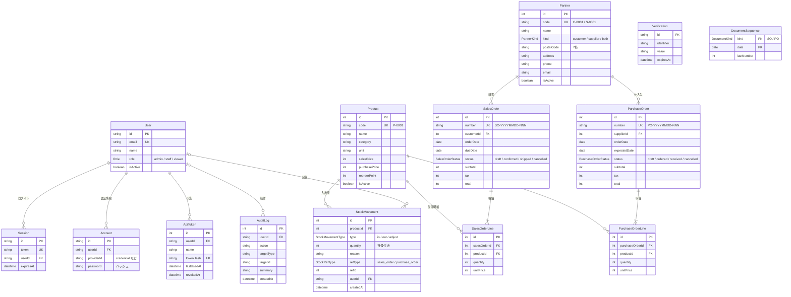

# StockFlow（Next.js）

受発注・在庫管理の社内業務システム（デモ）です。小規模な卸・小売事業者を想定し、商品・取引先・受注・発注・在庫をブラウザで管理します。

[](https://github.com/yuya1129t-project/stockflow-next/actions/workflows/ci.yml)

## このリポジトリについて

- 自社開発（個人の公開成果物）です。業務仕様は [docs/spec.md](docs/spec.md) にまとめています
- 実装は Claude Code が行い、要件整理・設計判断・レビュー・テスト確認は本人が行っています
- **データはすべて架空です**（実在の会社・人物・取引とは関係ありません）

## 主な機能

現時点では初期構築（土台）、DB スキーマ・シードデータ、認証とロール権限、商品マスタ、取引先マスタまでです。「予定」の機能は今後の Issue で実装します。

| 機能                   | 内容                                                                   | 状態   |
| ---------------------- | ---------------------------------------------------------------------- | ------ |
| 認証・ロール権限       | admin／staff／viewer。権限はサーバー側で検査                           | 実装済 |
| 商品マスタ             | 一覧・検索・登録・編集・無効化、CSV 出力・取込                         | 実装済 |
| 取引先マスタ           | 一覧・検索・登録・編集・無効化、郵便番号から住所を自動入力（外部 API） | 実装済 |
| 受注                   | 明細編集、税計算（1 件ごとに切り捨て）、ステータス遷移、出荷で在庫引当 | 予定   |
| 発注                   | 明細編集、ステータス遷移、入荷で在庫加算                               | 予定   |
| 在庫                   | 現在庫一覧（発注点割れの強調）、入出庫履歴、棚卸調整                   | 予定   |
| ダッシュボード         | 今月の受注額・未出荷数・発注点割れ・入荷待ち                           | 予定   |
| ユーザー管理・操作履歴 | ユーザー・ロール管理、API トークン、操作履歴の閲覧                     | 予定   |
| 外部向け REST API      | `/api/v1`（Bearer 認証）、OpenAPI 3.1                                  | 予定   |
| 通知                   | 発注点割れを Webhook で通知                                            | 予定   |

## 技術スタック

| 区分           | 採用技術                                           |
| -------------- | -------------------------------------------------- |
| フレームワーク | Next.js 16（App Router）／React 19                 |
| 言語           | TypeScript（strict）                               |
| UI             | Tailwind CSS 4／shadcn/ui                          |
| データベース   | PostgreSQL 17（ローカルは Docker Compose）         |
| ORM            | Prisma 7                                           |
| テスト         | Vitest                                             |
| 静的解析・整形 | ESLint（Next.js の flat config）／Prettier         |
| CI             | GitHub Actions（lint・型チェック・テスト・ビルド） |
| 実行環境       | Node.js 24 LTS／pnpm                               |

## ローカル開発

前提: Node.js 24（`.nvmrc`）、pnpm（`corepack enable pnpm` で `package.json` の版が使われます）、Docker。

```bash
# 1. 環境変数（ローカル用のダミー値）
cp .env.example .env

# 2. PostgreSQL を起動（ホスト側ポート 54329。DB は stockflow と stockflow_test）
docker compose up -d

# 3. 依存パッケージをインストール（postinstall で Prisma Client を src/generated/prisma に生成）
pnpm install

# 4. 開発用 DB を作り直してシードを投入（マイグレーション適用 → シード）
pnpm db:reset

# 5. 開発サーバーを起動 → http://localhost:3000
pnpm dev
```

http://localhost:3000 を開くとログイン画面が表示されます（デモ用アカウントは下の「認証と権限」）。3000 以外のポートで起動するときは、`.env` の `BETTER_AUTH_URL` もそのポートに合わせてください（例 `BETTER_AUTH_URL=http://localhost:3100 pnpm dev --port 3100`）。

DB を作り直したいときは `docker compose down -v` でボリュームごと削除してから起動し直します。

### DB 関連のコマンド

| コマンド             | 内容                                                                                             |
| -------------------- | ------------------------------------------------------------------------------------------------ |
| `pnpm db:migrate`    | スキーマ変更からマイグレーションを作成して開発用 DB に適用（`prisma migrate dev`）               |
| `pnpm db:reset`      | 接続先を確認してから開発用 DB を作り直し、シードを投入（**開発用 DB のデータはすべて消えます**） |
| `pnpm db:seed`       | シードだけを投入し直す（このアプリの 15 テーブルを空にしてから投入。他のテーブルには触れません） |
| `pnpm db:test:reset` | テスト用 DB（`DATABASE_URL_TEST`）にマイグレーションを適用してシードを投入                       |
| `pnpm db:generate`   | Prisma Client を生成（`pnpm install` 時にも自動で実行）                                          |

- スキーマは `prisma/schema.prisma`、マイグレーションは `prisma/migrations/`。数量 > 0・価格 ≥ 0 などの CHECK 制約はマイグレーション SQL に直接書いています
- Prisma Client の生成物（`src/generated/prisma`）はコミットしません
- データを消去するコマンド（`db:seed`・`db:reset`・`db:test:reset`）は、実行前に接続先の `host:port/DB` を表示し、接続先がローカル（`localhost`／`127.0.0.1`／`::1`）以外なら中止します。デモ環境の定期リセットなど意図した場合だけ `STOCKFLOW_ALLOW_DESTRUCTIVE_SEED=1` を設定してください
- テスト用 DB は、DB 名が `_test` で終わり、開発用 DB（`DATABASE_URL`）と別の DB であることを確認してから使います（`scripts/db-guard.ts`。結合テストの接続時も同じ確認をします）

### シードデータ

`prisma/seed-data.ts` で生成します（**すべて架空**）。

- 商品 50・取引先 20（顧客 12・仕入先 8）・受注 80・発注 40・入出庫履歴・デモユーザー 3 人（admin／staff／viewer）
- 取引先名には必ず「デモ」か「サンプル」を含め、メールは `example.com`／`example.jp`、電話番号・郵便番号は `000` 始まりの実在しない形式にしています
- 乱数は固定シードで、日付は実行日（JST）から過去約 90 日に分布します。いつ実行しても、日付がずれるだけで同じ内容になります
- 入出庫は時系列で生成し、どの時点でも在庫が負になりません。出荷済みの受注には出庫、入荷済みの発注には入庫が対応します。一部の商品は発注点を下回る状態にしています

### ER 図



- 現在庫は `StockMovement.quantity` の合計です（在庫数の列は持ちません）
- `User`／`Session`／`Account`／`Verification` は Better Auth のスキーマに合わせています（認証の設計は下の「認証と権限」）
- `StockMovement` の `refType`＋`refId` で発生元の受注・発注を指します（棚卸調整は空）

## 認証と権限

### デモ用アカウント

ログイン画面にも表示しています（クリックすると入力欄に入ります）。値は `prisma/seed-data.ts` の `DEMO_USERS`／`DEMO_PASSWORD` の 1 か所で定義し、ログイン画面はそこから読み込んでいます。

| ロール | メールアドレス     | パスワード       | できること                                                   |
| ------ | ------------------ | ---------------- | ------------------------------------------------------------ |
| admin  | admin@example.com  | `demo-pass-1234` | すべて（ユーザー管理・操作履歴の閲覧・商品等の無効化を含む） |
| staff  | staff@example.com  | `demo-pass-1234` | 閲覧、商品・取引先・受注・発注の登録・編集、棚卸調整、CSV    |
| viewer | viewer@example.com | `demo-pass-1234` | 閲覧と CSV 出力のみ                                          |

### 設計

- **認証:** [Better Auth](https://www.better-auth.com/) 1.7（メール＋パスワード、Prisma アダプター、DB セッション）。設定は `src/lib/auth/auth.ts`
  - 公開のサインアップは無効です（ユーザー登録は admin が行う。#10 で実装予定）
  - `role`・`isActive` はクライアントから設定できない項目（`input: false`）として登録しています
  - 無効ユーザー（`isActive = false`）はログインできません。ログイン中に無効化された場合も、セッションを取得するたびに DB の `isActive` を確認するので、次のリクエストから未ログインとして扱い、そのセッションを削除します（Cookie へのセッションのキャッシュは使っていません）
  - ログインは操作履歴（`audit_log`、action = `login`）に記録します
  - HTTP で公開する Better Auth のエンドポイントは `/api/auth/sign-in/email`・`/api/auth/sign-out`・`/api/auth/get-session` だけです（それ以外は 404）
  - **ログインの試行回数制限:** ログイン画面は HTTP の `/api/auth/sign-in/email` を経由します（Better Auth の制限は HTTP の経路にだけ効くため）。同じ IP から 60 秒に 5 回まで、超えると 429（画面には「試行回数が多すぎます…」と表示）。カウンターは Vercel の複数インスタンスでも共有できるよう DB（`rate_limit` テーブル）に置き、IP は Vercel が上書きする `x-forwarded-for` から取ります。制限は本番・開発で有効、自動テストでは既定で無効です（制限のテストでは有効にして検証）
- **権限:** ロール × 操作の対応表を `src/lib/auth/permissions.ts` の **1 か所**にまとめ、`can(role, action)` で判定します。表が docs/spec.md §2 と一致することは単体テストで spec の表を読み込んで確認しています
- **検査はサーバー側:** メニューの出し分けは表示の補助で、権限は必ずサーバー側のガード関数（`src/lib/auth/guards.ts`）で検査します
  - 画面: `requireUser()`／`requirePermission(action)`。未ログインはログイン画面へ（ログイン後に元の画面へ戻ります）、権限外は `forbidden()` で HTTP 403 を返し、403 の画面（`src/app/(app)/forbidden.tsx`）を表示します
    - `forbidden()` を使うため、`next.config.ts` で実験的な設定 `experimental.authInterrupts` を有効にしています（Next.js 16 で画面から HTTP 403 を返す手段がこれしかないため）
  - Server Action: `checkActionPermission(action)`。画面遷移はせず `{ ok: false, error }` を返すので、フォームの入力内容を消さずにエラーを表示できます
  - Route Handler: `requireApiPermission(request, action)`。未ログインは 401、権限外は 403 を JSON で返します
  - `src/proxy.ts`（Next.js 16 で Middleware から改名された Proxy）は、セッション Cookie が無いときにログイン画面へ送る楽観的なチェックだけを行います

## 商品マスタ

画面は `/products`（一覧）・`/products/new`（登録）・`/products/[id]`（詳細）・`/products/[id]/edit`（編集）・`/products/import`（CSV 取込）。

- **一覧:** 商品コード・商品名・カテゴリのキーワード検索、カテゴリでの絞り込み、無効な商品の表示切り替え、並べ替え（商品コード・商品名・カテゴリ・売価・発注点・現在庫）、20 件ずつのページ送り。検索条件は URL のクエリに持つので、URL の共有やブラウザの「戻る」で同じ一覧を再現できます
  - 現在庫は入出庫（`stock_movement`）の合計です。商品ごとに問い合わせず（N+1 にしない）、入出庫を商品ごとに集計した結果を 1 本の SQL で結合しています（`src/lib/products/queries.ts`）。現在庫が発注点を下回る有効な商品は「発注点割れ」として強調します
- **登録・編集:** React Hook Form＋Zod。Zod のスキーマ（`src/lib/products/schema.ts`）を画面と Server Action・CSV 取込で共有し、サーバー側で必ず検証します（エラーは日本語）。価格・発注点は 0 以上の整数（全角数字・3 桁区切りのカンマも受け付けます）。商品コードは大文字に揃えて保存し（`p-0001` と `P-0001` は同じ商品）、重複は「商品コード「…」はすでに登録されています」と表示します。商品名・カテゴリ・単位は 1 行の文字列で、改行・タブなどの制御文字はエラーです
- **無効化（論理削除）:** admin のみ。詳細画面から無効化・再有効化できます（確認ダイアログあり）
- **権限:** 登録・編集・CSV 取込は admin／staff、無効化は admin のみ（spec §2）。Server Action は `checkActionPermission` で検査し、更新処理の本体（`src/lib/products/service.ts`）でも操作したユーザーのロールを再度検査します
- **操作履歴:** 登録（`create`）・更新（`update`、変更した項目と前後の値）・無効化（`deactivate`）・再有効化（`reactivate`）・CSV 取込（商品ごとの `create`／`update` と、件数の要約の `import` 1 件）を `audit_log` に記録します。更新と履歴は同じトランザクションで書きます

### CSV

| 項目       | 出力（一覧の「CSV 出力」）                                                                             | 取込（`/products/import`）                                                              |
| ---------- | ------------------------------------------------------------------------------------------------------ | --------------------------------------------------------------------------------------- |
| 権限       | 全ロール（`csv:export`）                                                                               | admin／staff（`csv:import`）                                                            |
| 文字コード | UTF-8（BOM 付き。Excel で文字化けしない）                                                              | UTF-8（BOM の有無は問わない）。Shift_JIS などはエラー                                   |
| 列         | 商品コード・商品名・カテゴリ・単位・売価・仕入単価・発注点・現在庫・状態                               | 商品コード〜発注点の 7 列が必須（順番は問わない）。現在庫・状態などほかの列は読み飛ばす |
| 範囲       | 表示中の絞り込み条件・並び順を反映（ページ送りはせず全件）                                             | 商品コード（大文字に揃えて照合）が既存なら更新、なければ新規。有効／無効は変更しない    |
| 上限       | 10,000 件（超えると出力せず 413「件数が多すぎます。絞り込んでから…」。一覧でもボタンを無効にして表示） | データ 1,000 行・ファイル 512KB（512KB を超えるファイルは送信前に画面で止める）         |

- 出力は `GET /api/products/export?…`（一覧と同じクエリ）。読み取りだけで副作用はありません
- 出力では `=`・`+`・`-`・`@`（とタブ・CR）で始まる文字列のセル（`'` が並んだ後にこれらが続くものを含む）の先頭に `'` を 1 つ付けて、表計算ソフトで数式として実行されないようにしています（CSV インジェクション対策）。取込では `'` の後にこれらが続くセルから `'` を 1 つ外すので、元から `'` で始まる値も含めて、出力した CSV を編集してそのまま取り込めます
- 出力は取込の上限（1,000 行）を超えても出力できます。1,000 件を超える CSV を取り込むときは、ファイルを分けてください
- 取込は 1 行でもエラーがあれば全体を取り込まず、行番号・項目・内容の一覧を表示します。次もエラーです
  - ファイル内の商品コードの重複
  - 列の数が見出し行と違う行（囲んでいない `1,200` などで列がずれたまま取り込まないため）
  - RFC 4180 に沿わない引用（閉じた `"` の直後に文字が続く・囲んでいない項目の途中の `"`・閉じていない `"`）
- 書き込みは 1 トランザクションです。更新は `UPDATE … FROM (VALUES …)` で 500 行ずつまとめて実行します（ローカルの Docker の DB で、既存 1,000 件の更新を含む取込が約 1.6 秒）
- CSV の読み書きは外部ライブラリを使わず、小さな純粋関数（`src/lib/csv.ts`）にして単体テストしています

## 取引先マスタ

画面は `/partners`（一覧）・`/partners/new`（登録）・`/partners/[id]`（詳細）・`/partners/[id]/edit`（編集）。

- **一覧:** 取引先コード・取引先名のキーワード検索、種別（顧客／仕入先／顧客・仕入先。完全一致）での絞り込み、無効な取引先の表示切り替え、並べ替え（取引先コード・取引先名・種別）、20 件ずつのページ送り。検索条件は URL のクエリに持ちます
- **登録・編集:** React Hook Form＋Zod。スキーマ（`src/lib/partners/schema.ts`）を画面と Server Action で共有し、サーバー側で必ず検証します
  - 取引先コードは大文字に揃えて保存し（`c-0001` と `C-0001` は同じ取引先）、重複は「取引先コード「…」はすでに登録されています」と表示します。登録画面では種別に応じて次のコード（顧客 `C-0013`・仕入先 `S-0009`・顧客・仕入先 `B-0001` のように、既存の最大番号＋1）を初期値として提案します
  - 郵便番号は 7 桁（`123-4567`・`1234567`・全角も受け付け、保存はハイフンなし）。電話番号は 0 から始まる 10〜11 桁（ハイフンは任意）。郵便番号・住所・電話番号・メールアドレスは任意で、空なら未登録（null）にします。取引先名・住所は 1 行の文字列で、改行・タブなどの制御文字はエラーです
- **無効化（論理削除）:** admin のみ。詳細画面から無効化・再有効化できます（確認ダイアログあり）
- **権限:** 登録・編集は admin／staff、無効化は admin のみ（spec §2）。Server Action は `checkActionPermission` で検査し、更新処理の本体（`src/lib/partners/service.ts`）でも操作したユーザーのロールを再度検査します
- **操作履歴:** 登録（`create`）・更新（`update`、変更した項目と前後の値）・無効化（`deactivate`）・再有効化（`reactivate`）を `audit_log`（`targetType = partner`）に記録します。更新と履歴は同じトランザクションで書きます

### 郵便番号から住所を入力（外部 API 連携）

- 郵便番号を入れて「住所を検索」を押すと、住所欄に都道府県・市区町村・町域を入れます（候補が複数あれば選べます）。番地・建物名は続けて手入力します
- 外部 API は [zipcloud](https://zipcloud.ibsnet.co.jp/doc/api)（無料・API キー不要）。ブラウザから直接は呼ばず、サーバー側の Route Handler `GET /api/partners/address-lookup?postalCode=…` から呼びます（`src/lib/partners/address-lookup.ts`）
  - ログイン必須で、取引先を登録・編集できるロール（admin／staff）だけが使えます（未ログインは 401、権限外は 403）。読み取りだけで副作用はありません
  - タイムアウトは 3 秒（`AbortSignal.timeout`）。応答は Zod で型を検証してから使い、想定と違う形・問い合わせと違う郵便番号の結果・制御文字や長すぎる値は使いません
  - 応答: 200 `{ postalCode, addresses }`／400 形式エラー／404 該当なし／502 失敗・不正な応答／504 タイムアウト。失敗したときは画面に「…住所を手入力してください」と表示し、そのまま手入力して保存できます（住所検索は保存の条件ではありません）
- テストでは外部 API を呼びません。`fetch` をモックにして、正常・複数候補・該当なし・タイムアウト（応答の途中を含む）・HTTP エラー・通信エラー・不正な応答（JSON でない・型が違う・別の郵便番号）を確認しています（`src/lib/partners/address-lookup.test.ts`・`src/app/api/partners/address-lookup/route.test.ts`）

## テスト

```bash
pnpm test              # 単体テスト＋結合テスト（Vitest）
pnpm test:unit         # 単体テストのみ（DB 不要）
pnpm test:integration  # 結合テストのみ（実 DB = DATABASE_URL_TEST）
pnpm lint              # ESLint
pnpm typecheck         # 型チェック
pnpm build             # 本番ビルド
pnpm format            # Prettier で整形
```

結合テスト（`tests/integration/`）はテスト用 DB（`stockflow_test`）を使います。先に `docker compose up -d` と `pnpm db:test:reset` を実行してください。DB に接続できないときは、その旨と対処を示すエラーで失敗します。CI では PostgreSQL 17 のサービスを起動し、`pnpm db:test:reset` のあとに全テストを実行しています。

## デモ

（#14 で追加予定）

## REST API

（#11 で追加予定）

## 開発の進め方

1. GitHub Issue でタスクを切る（1 Issue = 1 ブランチ = 1 PR）
2. `feat/<issue番号>-<短い名前>` ブランチで実装
3. PR を作成し、レビュー 2 本の指摘に対応
4. CI（lint・型チェック・テスト・ビルド）が緑であることを確認
5. main にマージ
